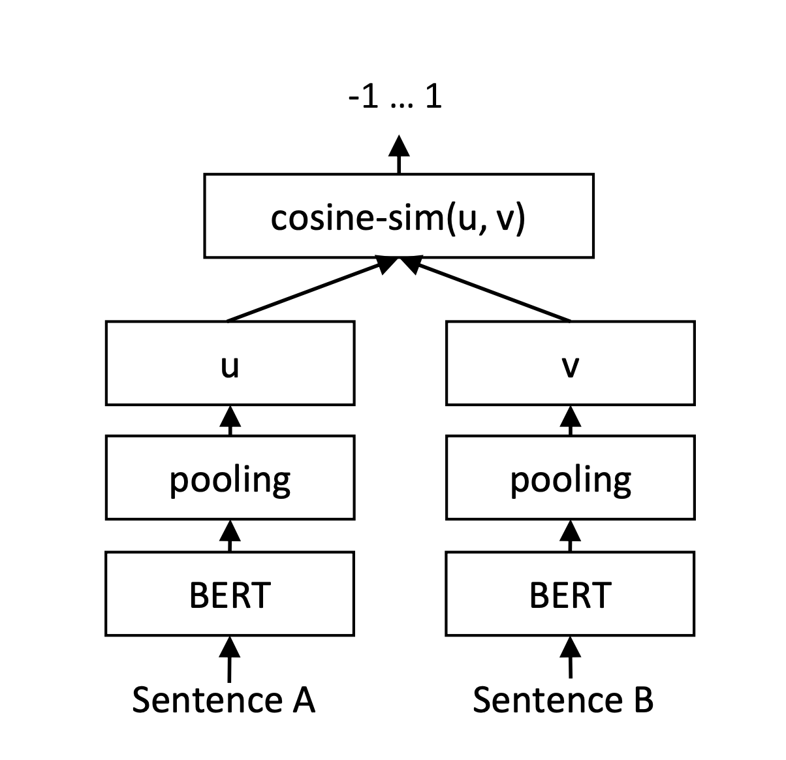
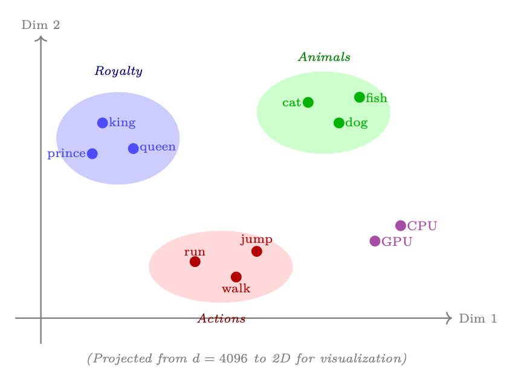

[](https://colab.research.google.com/github/Adamychen/m10_quarto/blob/main/notebooks/bloque1/01c-embeddings.ipynb)

> Este tema forma parte del Bloque 1 — Fundamentos. Se recomienda haber visto [01b-llms.qmd](01b-llms.qmd) primero.

> Este tema profundiza en la línea histórica presentada en el [panorama del Bloque 1](00-panorama.qmd). Allí se introducen one-hot, TF-IDF, word2vec, representaciones contextuales y SBERT; aquí se estudian sus mecanismos, modelos actuales y consecuencias geométricas.

```{python}
#| echo: true
#| eval: false

!pip install -q sentence-transformers matplotlib scikit-learn

```

```{python}
#| echo: true

import os
os.environ["TOKENIZERS_PARALLELISM"] = "false"
import warnings
warnings.filterwarnings("ignore")
import numpy as np
import matplotlib.pyplot as plt
plt.rcParams["figure.dpi"] = 100
print("Librerías cargadas correctamente.")

```

## 0. Qué significa «embedding» en este bloque {#sec-que-significa-embedding}

La palabra *embedding* se utiliza para varias piezas relacionadas, pero no idénticas. En todos los casos se trata de representar un objeto mediante un vector aprendido o calculado. Lo que cambia es el objeto representado, el momento del pipeline y el objetivo con el que se entrenó el vector.

| Tipo de representación | Entrada | Depende del contexto | Uso típico |
|---|---|---:|---|
| **Embedding de token** | ID de una unidad del vocabulario | No, al inicio del modelo | Entrada de un Transformer |
| **Estado oculto contextual** | Secuencia de tokens procesada | Sí | Clasificación, generación, extracción |
| **Embedding de palabra estático** | Palabra del vocabulario | No | Similitud léxica y transferencia |
| **Embedding de frase** | Frase o consulta completa | Sí, mediante el encoder | Búsqueda semántica |
| **Embedding de documento** | Documento o chunk | Sí, según el modelo y el pooling | Indexación y RAG |

Por tanto, no todo vector producido por un modelo es automáticamente un buen embedding para búsqueda. Un estado oculto puede contener información útil para predecir el siguiente token, pero necesitar una transformación o un entrenamiento adicional para que las distancias entre frases sean interpretables.

::: {.callout-warning}
## Tres conceptos que no conviene confundir

1. La tabla de embeddings convierte IDs en vectores al comienzo del Transformer.
2. Las capas Transformer convierten esos vectores en estados ocultos que incorporan contexto.
3. Un modelo como SBERT o E5 se entrena específicamente para que la distancia entre vectores de frases tenga utilidad para similitud y recuperación.

El [tema 01a](01a-transformer.qmd#sec-vistazo-transformer) muestra el recorrido interno, y [Del estado oculto a la salida](../bloque3/03c-previo-cabezas.qmd) (Bloque 3) explica cómo distintas cabezas pueden leer esos estados.
:::

## Modelos de Embeddings {#sec-modelos-embeddings}

### Qué ha cambiado desde word2vec {#sec-word2vec-sentence}

La historia hasta SBERT (one-hot, TF-IDF, word2vec, BERT) está contada en el [panorama histórico](00-panorama.qmd). Aquí solo conviene fijar la cronología de los modelos que hoy puedes elegir:

::: {#fig-timeline-embeddings}
```{mermaid}
timeline
    title Evolución de los embeddings
    1957 : Firth : Semántica distribucional
    2013 : word2vec (Mikolov) : Vectores por palabra
    2018 : BERT (Devlin) : Embeddings contextuales
    2019 : Sentence-BERT (Reimers) : Embeddings de frases
    2020 : DPR y RAG : Recuperación densa y generación aumentada
    2022 : E5 (Microsoft) : Embeddings open-source
    2024 : text-embedding-3 (OpenAI) : Embeddings comerciales
    2024 : BGE-M3 (BAAI) : Multilingüe + multifunción
    2025 : Qwen3-Embedding : Embeddings nativos Qwen
```
:::

Cada etapa resolvió un problema y dejó otro abierto. Lo que permanece hoy es esto: **la calidad de un modelo de embeddings depende del dominio, del idioma y de los datos con que se entrenó**, y por eso hay que medirla sobre tus propios documentos (@sec-comparativa-embeddings y el HPD 1).

### Del embedding estático al embedding contextual {#sec-estatico-contextual}

En un embedding estático, cada palabra tiene una única posición aprendida. En una representación contextual, la posición depende de los tokens que aparecen alrededor. Esta diferencia permite representar usos distintos de una misma forma ortográfica:

```text
El banco aprobó la hipoteca.
El banco estaba junto al río.
```

Un encoder contextual puede producir estados distintos para `banco` en cada frase. Esa capacidad no significa que el modelo haya construido una definición explícita en lenguaje natural. Significa que las capas han transformado la representación teniendo en cuenta las relaciones con el resto de la secuencia.

El paso desde estados por token a un único vector de frase exige además una operación de agregación. Las estrategias habituales incluyen:

- **Mean pooling:** promediar los estados de los tokens válidos.
- **CLS pooling:** utilizar el estado de un token especial, cuando el modelo lo ha entrenado para ello.
- **Pooling aprendido:** combinar los estados mediante una capa entrenable.
- **Representación contrastiva:** entrenar el encoder para que pares relevantes queden próximos y pares no relevantes queden separados.

La elección del pooling y del objetivo de entrenamiento puede cambiar sustancialmente la calidad de la búsqueda, incluso cuando el backbone Transformer es el mismo.

### Nuestro caso conductor: el buscador de preguntas frecuentes de un banco {#sec-caso-conductor}

En las páginas 01c, 01d y 01e vamos a construir, paso a paso, el buscador de la sección de ayuda de un banco ficticio. Es un caso pequeño, en español y con trampas realistas: sinónimos, cifras, códigos de error. El mismo corpus se reutiliza en las tres páginas para que puedas comparar técnicas sobre los mismos datos.

::: {.callout-note}
## Idioma y modelo

Los modelos de embeddings dependen del idioma con que se entrenaron. En esta página usamos `paraphrase-multilingual-MiniLM-L12-v2`, un modelo multilingüe pequeño, porque nuestro corpus está en español. Más abajo, en [Cuándo fallan los embeddings](#sec-cuando-fallan), medimos qué ocurre si usas un modelo solo inglés con textos en español.
:::

```{python}
#| echo: true
#| eval: true

from sentence_transformers import SentenceTransformer

modelo = SentenceTransformer("paraphrase-multilingual-MiniLM-L12-v2")

faq = [
    "Puedes pagar con tarjeta de crédito o débito en cualquier comercio adherido.",
    "No se admite el pago con tarjeta en operaciones superiores a 3.000 euros; usa transferencia.",
    "Para pedir un reembolso, solicita la devolución en la app en un plazo de 14 días.",
    "La comisión por transferencia SEPA es de 0,50 euros por operación.",
    "Las transferencias internacionales tienen una comisión del 2 % del importe.",
    "Si pierdes tu tarjeta, bloquéala desde la app o llama al teléfono de atención 24 horas.",
    "El IBAN es el código que identifica tu cuenta bancaria en transferencias nacionales e internacionales.",
    "Para cambiar tu contraseña, entra en Ajustes > Seguridad y pulsa «Restablecer».",
    "El límite diario de retirada en cajeros es de 600 euros.",
    "Abrir una cuenta nueva es gratis y se completa en cinco minutos con tu DNI.",
    "Los préstamos personales se conceden en 24 horas si tienes la nómina domiciliada.",
    "La hipoteca a tipo variable se revisa cada seis meses según el Euríbor.",
    "Error E-4021: la operación fue rechazada por saldo insuficiente.",
    "Error E-4012: la tarjeta ha caducado y debe renovarse.",
]

emb_faq = modelo.encode(faq, normalize_embeddings=True)
print(f"{len(faq)} preguntas frecuentes → matriz de embeddings {emb_faq.shape}")
print("Primeros 5 números del primer embedding:", emb_faq[0][:5].round(3))
```

Cada frase es ahora un punto en un espacio de 384 dimensiones. Veamos qué documentos quedan cerca de una consulta. **Antes de ejecutar, predice:** estas dos consultas no comparten ninguna palabra con la respuesta correcta («devuelvan el dinero» frente a «reembolso»; «clave de acceso» frente a «contraseña»). ¿Las encontrará?

```{python}
#| echo: true
#| eval: true

import numpy as np

def buscar_faq(consulta, k=3):
    q = modelo.encode([consulta], normalize_embeddings=True)
    puntuaciones = (q @ emb_faq.T)[0]
    for i in np.argsort(-puntuaciones)[:k]:
        print(f"  {puntuaciones[i]:.2f}  {faq[i]}")

for consulta in ["Quiero que me devuelvan el dinero de una compra", "he olvidado mi clave de acceso"]:
    print(f"Consulta: «{consulta}»")
    buscar_faq(consulta)
```

En los dos casos la respuesta correcta (la del reembolso y la de la contraseña) aparece en primer lugar, aunque no comparten ninguna palabra con la consulta. Eso es lo que no podía hacer TF-IDF. Fíjate también en que las puntuaciones son modestas (en torno a 0,5): lo que importa es el **orden**, no el valor absoluto.

Ahora una vista global: la matriz de similitudes entre las 14 frases.

```{python}
#| echo: true
#| eval: true

import matplotlib.pyplot as plt
from sklearn.metrics.pairwise import cosine_similarity
plt.rcParams["figure.dpi"] = 100

sim_matrix = cosine_similarity(emb_faq)
fig, ax = plt.subplots(figsize=(6, 5))
im = ax.imshow(sim_matrix, cmap="Blues", vmin=0, vmax=1)
ax.set_xticks(range(len(faq))); ax.set_yticks(range(len(faq)))
ax.set_xticklabels([f"F{i}" for i in range(len(faq))], fontsize=7)
ax.set_yticklabels([f"F{i}" for i in range(len(faq))], fontsize=7)
ax.set_title("Similitud coseno entre las 14 preguntas frecuentes")
plt.colorbar(im, ax=ax)
plt.tight_layout()
plt.show()
```

Las parejas más parecidas son las que comparten tema: los códigos de error (F12 y F13), las comisiones (F3 y F4) o los pagos con tarjeta (F0 y F1). Fíjate en F12 y F13: son casi iguales en forma y distintas en contenido. Volveremos sobre ello. Y ten en cuenta que, fuera de la diagonal, casi todos los valores están entre 0,1 y 0,5: la similitud entre frases distintas rara vez es alta.

### Cómo se entrena un modelo de embeddings: la intuición contrastiva {#sec-intuicion-contrastiva}

Un modelo como SBERT o E5 no aprende «qué significa» una frase. Aprende a **acercar lo que debe estar junto y alejar lo demás**. Para ello se le dan pares (pregunta, respuesta que la contesta) y, dentro de cada lote, las respuestas de las otras preguntas actúan como ejemplos negativos gratuitos. Con tres pares:

```{python}
#| echo: true
#| eval: true

preguntas = ["¿Cómo bloqueo mi tarjeta si la pierdo?", "¿Cuánto cuesta una transferencia SEPA?", "¿Qué es el IBAN?"]
respuestas = [faq[5], faq[3], faq[6]]            # la respuesta correcta de cada pregunta, en el mismo orden

Q = modelo.encode(preguntas, normalize_embeddings=True)
R = modelo.encode(respuestas, normalize_embeddings=True)
S = Q @ R.T                                       # S[i, j] = similitud de la pregunta i con la respuesta j
print("Similitudes (filas = preguntas, columnas = respuestas):")
print(np.round(S, 2))
print("La diagonal son los pares correctos; el resto son los 'negativos' del lote.")
```

La diagonal tiene valores altos y el resto bajos. El entrenamiento convierte esa idea en una pérdida: para cada pregunta, calcula un *softmax* sobre todas las respuestas del lote y penaliza que la probabilidad de la correcta sea baja [@oord2018cpc]:

$$
\mathcal{L} = -\frac{1}{N}\sum_{i=1}^{N} \log \frac{e^{s_{ii}/\tau}}{\sum_{j=1}^{N} e^{s_{ij}/\tau}}
$$

donde $s_{ij}$ es la similitud coseno y $\tau$ es una «temperatura» (la misma idea que en la generación de texto). Calculémosla con dos valores de $\tau$:

```{python}
#| echo: true
#| eval: true

def perdida_contrastiva(S, tau):
    P = np.exp(S / tau)
    P = P / P.sum(axis=1, keepdims=True)          # softmax por filas
    return -np.log(np.diag(P)).mean(), np.diag(P)

for tau in [1.0, 0.05]:
    perdida, p_correcta = perdida_contrastiva(S, tau)
    print(f"τ = {tau:<4}  probabilidad asignada a la respuesta correcta: {np.round(p_correcta, 2)}  → pérdida = {perdida:.3f}")
```

Con $\tau = 1$ el modelo reparte la probabilidad casi a partes iguales y la pérdida es alta, aunque las similitudes ya son «buenas». Con $\tau$ pequeña (valores como 0,05 son habituales) las diferencias se amplifican y la pérdida cae. Durante el entrenamiento se ajustan los pesos del encoder para subir la diagonal y bajar el resto, sobre millones de pares. De ahí salen dos consecuencias prácticas:

- **El modelo es tan bueno como sus pares de entrenamiento.** Si nunca vio pares de tu dominio (contratos, historiales clínicos, código), rendirá peor.
- **Las puntuaciones no son comparables entre modelos.** Cada uno se entrena con su propia $\tau$ y su propia distribución; un coseno de 0,8 significa cosas distintas en cada modelo (lo comprobaremos más abajo).

### Sentence-BERT {#sec-sbert}

> **Demo interactiva:** [vecinos semánticos frente a vecinos léxicos](../demos/embeddings.qmd) con embeddings reales sobre frases en español.

Sentence-BERT (SBERT) modifica BERT con una arquitectura siamesa que permite generar embeddings de frases comparables directamente. Usa funciones de pérdida contrastiva (triplet loss, cosine similarity loss) para que frases semánticamente cercanas tengan vectores cercanos.

{#fig-sbert-arch fig-cap="Arquitectura siamesa de SBERT para inferencia: dos torres BERT con pesos compartidos producen embeddings u y v que se comparan con cosine similarity. Adaptada de @reimers2019sbert, Figure 2 (https://aclanthology.org/D19-1410/), distribuida bajo CC-BY 4.0."}

### Comparativa de modelos de embeddings {#sec-comparativa-embeddings}

: Comparativa de modelos de embeddings por dimensiones, tamaño y caso de uso {#tbl-modelos-embeddings}

| Modelo | Dimensiones | Tamaño | Uso |
|---|---|---|---|
| `all-MiniLM-L6-v2` | 384 | ~80 MB | Prototipado rápido (inglés) |
| `paraphrase-multilingual-MiniLM-L12-v2` | 384 | ~470 MB | Prototipado multilingüe (el de esta página) |
| `intfloat/e5-small-v2` | 384 | ~120 MB | Propósito general open-source (inglés) |
| `intfloat/e5-base-v2` | 768 | ~440 MB | Mayor precisión (inglés) |
| `qwen3-embedding:0.6b` | 1024 | ~640 MB | Embeddings nativos Qwen (disponible en Llamus) |
| `nomic-embed-text-v2-moe` | 768 | ~475 MB | Alta precisión, MoE eficiente |
| `mxbai-embed-large:v1` | 1024 | ~334 MB | Embeddings densos generales |
| `text-embedding-3-small` | 512 o 1536 | API | Comercial (OpenAI) |
| `text-embedding-3-large` | 256 o 3072 | API | Alta precisión (OpenAI) |

::: {.callout-warning}
## Mira siempre el límite de tokens y el prefijo del modelo

Cada modelo corta el texto en silencio a partir de un número máximo de tokens (`modelo.max_seq_length`). Medido con `sentence-transformers`: `paraphrase-multilingual-MiniLM-L12-v2` corta a **128**, `all-MiniLM-L6-v2` a **256** y `intfloat/e5-small-v2` a **512**. Lo que sobra se ignora sin avisar (lo vemos en [Cuándo fallan los embeddings](#sec-cuando-fallan)). Además, la familia E5 espera que antepongas `query: ` a las consultas y `passage: ` a los documentos; consulta la ficha del modelo antes de usarlo.
:::

### Embeddings multimodales y tabulares {#sec-multimodales-tabulares}

- **Multimodales (CLIP):** proyectan texto e imágenes en un mismo espacio vectorial, permitiendo búsqueda cross-modal (ej. «un perro jugando en la nieve» → imágenes correspondientes) [@radford2021clip].
- **Tabulares:** hay dos caminos. El más práctico es **convertir cada fila en una frase** y usar un modelo de texto (lo harás en el HPD 1). El más riguroso es entrenar un modelo específico; por ejemplo, SCARF aprende representaciones de filas de forma autosupervisada, corrompiendo características al azar y aplicando una pérdida contrastiva [@bahri2022scarf]. Requiere entrenar con tus propios datos.
- **Código:** existen modelos entrenados con código fuente (CodeBERT, UniXcoder) para búsqueda semántica sobre repositorios.

::: {.callout-note}
## ¿Cuándo usar cada uno?

- **Texto:** Sentence-BERT / E5 / BGE → **Vector DB**
- **Texto + imágenes:** CLIP → **Búsqueda multimodal**
- **Datos tabulares:** texto de la fila + modelo de texto (rápido) o SCARF (riguroso, requiere entrenamiento)
- **Código:** modelos entrenados con código → **Búsqueda semántica de código**
:::

### La geometría del espacio semántico {#sec-geometria-semantica}

La intuición central de los embeddings es que la proximidad vectorial codifica proximidad semántica. En un espacio bien entrenado:

- Conceptos similares caen cerca (rey, reina, príncipe).
- Conceptos distintos caen lejos (rey, bicicleta, GPU).
- En los vectores de palabras clásicos (word2vec, GloVe), algunas relaciones se pueden capturar con aritmética vectorial:
  $\vec{\text{king}} - \vec{\text{man}} + \vec{\text{woman}} \approx \vec{\text{queen}}$.

{#fig-embedding-space-2d}

::: {#fig-analogia-vectorial}
```{mermaid}
flowchart LR
    K["king"]:::royalty -->|"− man"| K2["king − man"]:::diff
    M["man"]:::person --> K2
    K2 -->|"+ woman"| K3["king − man + woman"]:::result
    W["woman"]:::person --> K3
    K3 -.->|"≈"| Q["queen"]:::royalty

    classDef royalty fill:#c5cae9,stroke:#3949ab,color:#1a237e,stroke-width:1.5px
    classDef person  fill:#ffe0b2,stroke:#e65100,color:#000,stroke-width:1.5px
    classDef diff    fill:#fff9c4,stroke:#f9a825,color:#000,stroke-width:1.5px
    classDef result  fill:#c8e6c9,stroke:#2e7d32,color:#1b5e20,stroke-width:2px
```
:::

::: {.callout-note}
## Lectura de la imagen y el diagrama

La imagen proyecta un espacio de miles de dimensiones en un plano 2D —pierde información exacta— pero conserva la estructura por clusters: las palabras se agrupan por tema, no por sintaxis. El diagrama ilustra la analogía vectorial: sumar y restar direcciones (`man → woman`, género) sobre un vector (`king`) aterriza cerca de `queen`.

**Dos matices honestos.** La analogía es una curiosidad de los vectores de *palabras* estáticos y funciona solo en parte: con frecuencia el resultado más cercano es la propia palabra de partida o un vecino sin relación. Con los embeddings de *frase* de esta página no tiene sentido aplicarla. Lo que sí se mantiene —y es lo que explota un sistema RAG— es la idea básica: lo que significa algo parecido queda cerca.
:::

## Cuándo fallan los embeddings {#sec-cuando-fallan}

Un buscador semántico siempre devuelve algo. Que lo devuelto sea correcto es otra cuestión. Estos seis casos sobre nuestro banco ficticio conviene tenerlos presentes antes de construir un RAG. Cada uno responde a un problema que encontrarás en producción.

### Caso 1: negación y contradicciones {#sec-fallo-negacion}

**Antes de ejecutar, predice:** «El banco aprobó la hipoteca» y «El banco *no* aprobó la hipoteca» dicen lo contrario. ¿Estarán lejos o cerca en el espacio?

```{python}
#| echo: true
#| eval: true

def coseno(a, b):
    e = modelo.encode([a, b], normalize_embeddings=True)
    return float(e[0] @ e[1])

base = "El banco aprobó la hipoteca."
for otra in ["El banco no aprobó la hipoteca.",
             "El banco concedió el préstamo hipotecario.",
             "Mañana lloverá en Sevilla."]:
    print(f"  {coseno(base, otra):.2f}  {otra}")
```

La frase negada queda **mucho más cerca de la original que de una frase sin relación**, aunque signifique lo contrario. Un embedding mide «de qué se habla», no «qué se afirma». Consecuencia: si buscas «¿se admite el pago con tarjeta?», puede devolverte el documento que dice que **no** se admite, y un LLM que lo reciba como contexto debe saber leerlo con cuidado.

### Caso 2: cifras {#sec-fallo-cifras}

```{python}
#| echo: true
#| eval: true

docs_cifras = [
    "El límite diario de retirada en cajeros es de 600 euros.",
    "El límite diario de retirada en cajeros es de 6.000 euros.",
]
emb_c = modelo.encode(docs_cifras, normalize_embeddings=True)
for consulta in ["límite de 600 euros en cajeros", "¿Puedo retirar 6.000 euros en un cajero?"]:
    s = (modelo.encode([consulta], normalize_embeddings=True) @ emb_c.T)[0]
    print(f"{consulta!r}: 600 → {s[0]:.2f} · 6.000 → {s[1]:.2f}")
```

El modelo distingue algo entre ambos documentos, pero la diferencia es de entre 3 y 9 centésimas, mientras que la que separa un tema de otro es de décimas. **Las cifras apenas pesan**: no confíes en que un embedding distinga 600 de 6.000, 2 % de 20 % o 2023 de 2024.

### Caso 3: códigos, siglas e identificadores {#sec-fallo-codigos}

```{python}
#| echo: true
#| eval: true

for consulta in ["error E-4021", "¿qué significa el error E-4012?"]:
    print(f"Consulta: {consulta}")
    buscar_faq(consulta, k=2)
```

Con la segunda consulta, el modelo puede devolver el código equivocado primero. Para un humano, `E-4012` y `E-4021` son identificadores distintos; para el modelo son dos «códigos de error» casi intercambiables. **Los identificadores exactos son terreno de la búsqueda léxica** (BM25), no de los embeddings. Lo resolveremos combinando ambas en [De documentos a recuperación](01e-recuperacion.qmd).

### Caso 4: el idioma del modelo {#sec-fallo-idioma}

Hacemos 8 consultas en español y medimos cuántas veces el documento correcto queda en primer lugar con tres modelos:

```{python}
#| echo: true
#| eval: true

consultas = [
    ("¿Cómo bloqueo mi tarjeta si la pierdo?", 5), ("¿Cuánto cuesta una transferencia SEPA?", 3),
    ("¿Cómo restablezco mi contraseña?", 7), ("¿Cuánto puedo sacar en un cajero?", 8),
    ("¿Qué es el IBAN?", 6), ("¿Cuánto tardan en darme un préstamo?", 10),
    ("¿Cada cuánto se revisa la hipoteca variable?", 11), ("¿Es gratis abrir una cuenta?", 9),
]

candidatos = {
    "multilingüe (paraphrase-multilingual-MiniLM)": (modelo, "", ""),
    "solo inglés (all-MiniLM-L6-v2)": (SentenceTransformer("all-MiniLM-L6-v2"), "", ""),
    "solo inglés (e5-small-v2)": (SentenceTransformer("intfloat/e5-small-v2"), "query: ", "passage: "),
}

for nombre, (m, pref_q, pref_d) in candidatos.items():
    D = m.encode([pref_d + t for t in faq], normalize_embeddings=True)
    aciertos = 0
    for consulta, correcto in consultas:
        q = m.encode([pref_q + consulta], normalize_embeddings=True)
        aciertos += int(np.argmax((q @ D.T)[0]) == correcto)
    print(f"{nombre:<48} {aciertos}/{len(consultas)} aciertos en el primer puesto")
```

Los modelos solo inglés fallan en una parte de las consultas, y con un corpus de solo 14 documentos: con miles de documentos la diferencia será mayor. Es la razón por la que, en el [HPD 1](hpd1-embeddings.qmd), usamos un corpus en inglés con un modelo inglés. **Modelo e idioma deben ir a juego.**

### Caso 5: el texto largo se corta en silencio {#sec-fallo-truncado}

```{python}
#| echo: true
#| eval: true

relleno = " ".join(["El proceso estándar de verificación incluye varios pasos administrativos."] * 40)
doc_a = relleno + " Al final: la cuenta queda CANCELADA."
doc_b = relleno + " Al final: la cuenta queda ACTIVADA."

ea, eb = modelo.encode([doc_a, doc_b], normalize_embeddings=True)
n_tokens = len(modelo.tokenizer(doc_a)["input_ids"])
print(f"Longitud del documento: {n_tokens} tokens · límite del modelo: {modelo.max_seq_length}")
print(f"Similitud entre 'CANCELADA' y 'ACTIVADA': {float(ea @ eb):.4f}")
```

Los dos documentos dicen lo contrario en su última frase, pero el modelo solo «lee» los primeros 128 tokens. La similitud es 1,0000. **Todo lo que supere el límite de tokens del modelo es invisible.** Esta es una de las razones de que se trocee (*chunking*) los documentos antes de indexarlos, tema de la página [De documentos a recuperación](01e-recuperacion.qmd).

### Caso 6: siempre hay un «vecino más cercano», y el coseno no está calibrado {#sec-fallo-sin-respuesta}

¿Qué ocurre si la pregunta no tiene respuesta en el corpus?

```{python}
#| echo: true
#| eval: true

e5 = SentenceTransformer("intfloat/e5-small-v2")
D_e5 = e5.encode(["passage: " + t for t in faq], normalize_embeddings=True)
D_ml = emb_faq

for consulta in ["¿Cómo bloqueo mi tarjeta si la pierdo?", "receta de paella valenciana"]:
    s_ml = (modelo.encode([consulta], normalize_embeddings=True) @ D_ml.T)[0]
    s_e5 = (e5.encode(["query: " + consulta], normalize_embeddings=True) @ D_e5.T)[0]
    print(f"{consulta!r}")
    print(f"   multilingüe: mejor coseno = {s_ml.max():.2f}")
    print(f"   e5-small-v2: mejor coseno = {s_e5.max():.2f}   (rango de todos los cosenos: {s_e5.min():.2f}–{s_e5.max():.2f})")
```

Una pregunta sobre paella devuelve «el documento más cercano» con ambos modelos. La diferencia está en la **puntuación**: con el modelo multilingüe es casi cero y se nota que no hay nada relevante; con E5 sale en torno a 0,8, es decir, **parecida a la de una consulta bien respondida**, porque este modelo concentra todas sus similitudes en un rango estrecho (aprox. 0,7–0,9). Consecuencias:

- No existe un umbral universal («si coseno > 0,7, es relevante»). Hay que calibrarlo para cada modelo y corpus.
- Un sistema RAG que siempre pasa los *k* vecinos al LLM puede alimentarlo con material irrelevante. Conviene permitir que el sistema diga «no encontré nada» (lo retomaremos en el Bloque 3).

## Comprueba lo aprendido {#sec-comprueba-01c}

::: {.callout-note collapse="true" title="1. Una consulta para tu buscador de contratos es «cláusula 14.3 sobre penalizaciones». ¿Por qué un embedding por sí solo puede fallar y qué le añadirías?"}
Porque los números de cláusula son identificadores y los embeddings apenas distinguen cifras o códigos (casos 2 y 3). Le añadirías búsqueda léxica (BM25) combinada con la semántica, o un filtro por metadatos.
:::

::: {.callout-note collapse="true" title="2. Tu corpus está en español y tu equipo propone all-MiniLM-L6-v2 «porque es pequeño y rápido». ¿Qué comprobarías antes?"}
Que el modelo soporte español (este es solo inglés) y medir su acierto sobre consultas reales de tu dominio, comparándolo con un modelo multilingüe. Con 14 documentos ya perdía 2 de 8 consultas; con un corpus real la diferencia suele crecer.
:::

::: {.callout-note collapse="true" title="3. ¿Por qué el entrenamiento contrastivo usa las respuestas de otras preguntas del lote como negativos?"}
Porque son gratuitas: ya están en el lote, y casi seguro que no responden a la pregunta actual. Obligan al modelo a distinguir entre respuestas, no solo a hacer que las correctas tengan una similitud alta en términos absolutos.
:::

::: {.callout-note collapse="true" title="4. Un documento de 5.000 palabras se indexa con un modelo cuyo límite es 256 tokens. ¿Qué parte del documento se «ve»?"}
Solo aproximadamente las primeras 150-200 palabras (según el idioma). El resto no influye en el embedding, aunque el documento se almacene entero. Hay que trocear el documento en fragmentos que quepan en el límite del modelo.
:::

---

> Continúa con **[01d-vectordb.qmd](01d-vectordb.qmd)** — Bases de datos vectoriales.

# References

::: {#refs}
:::
